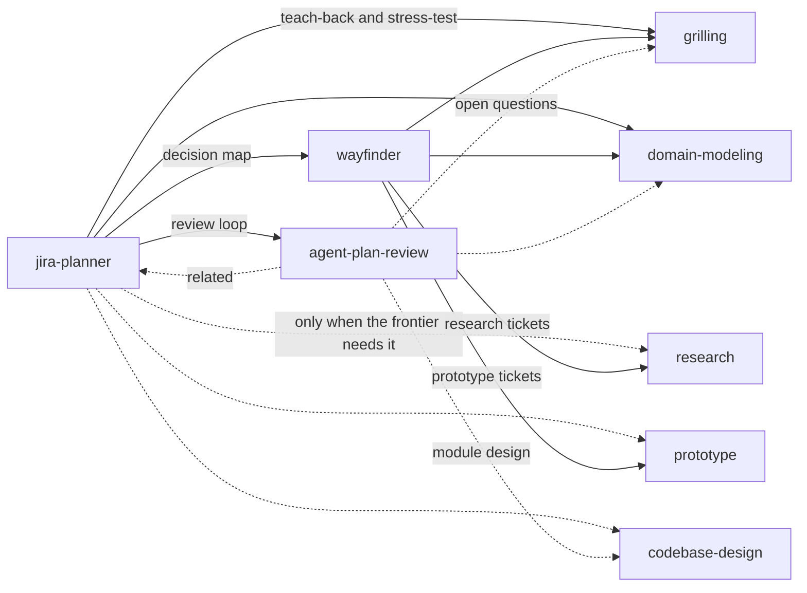
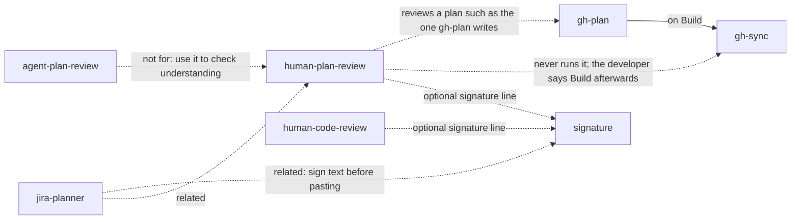
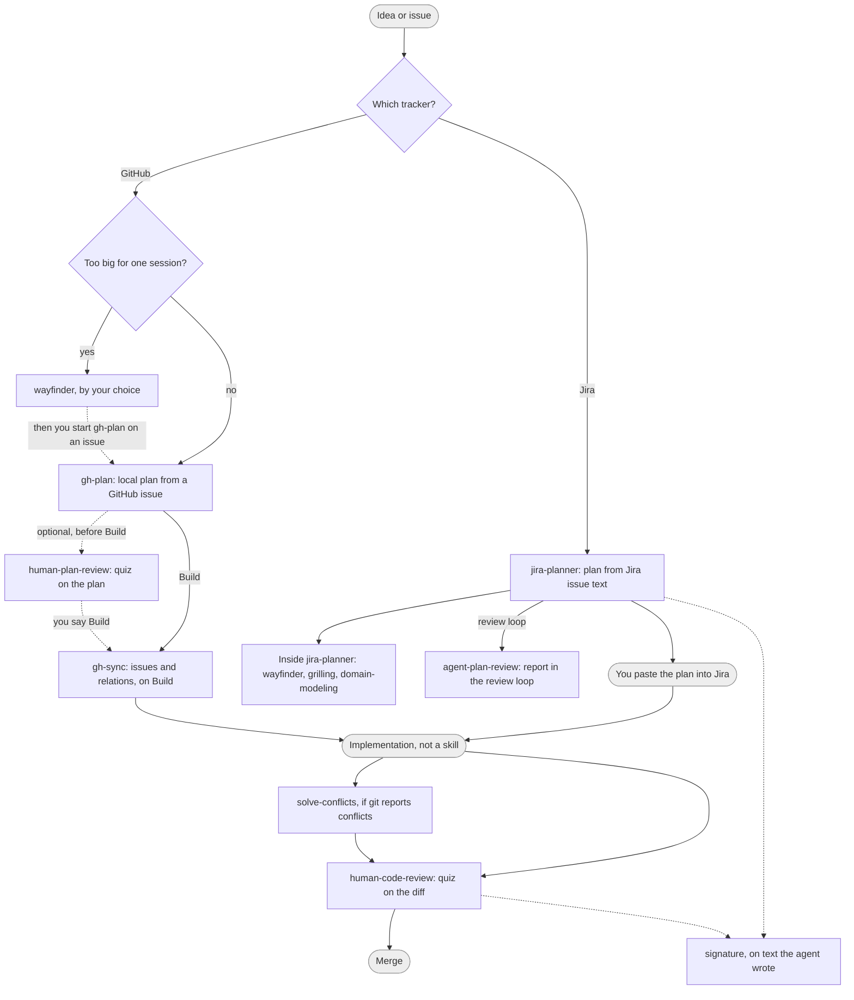
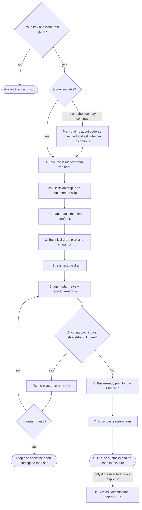
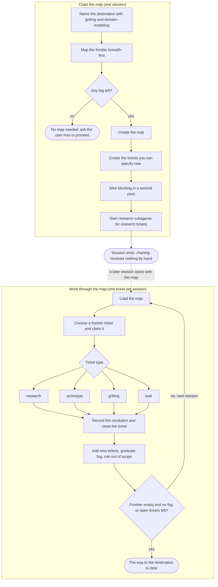
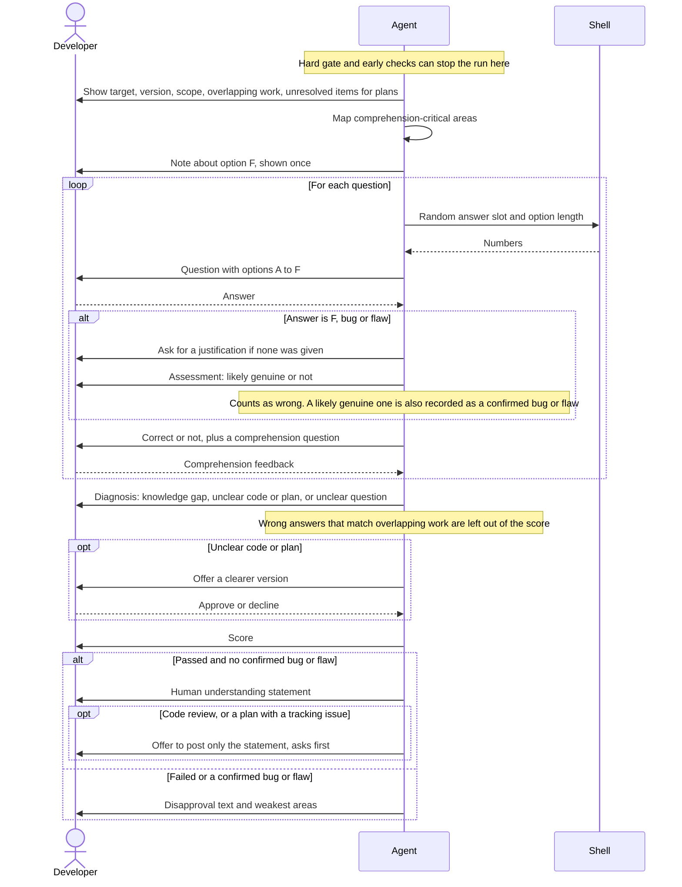
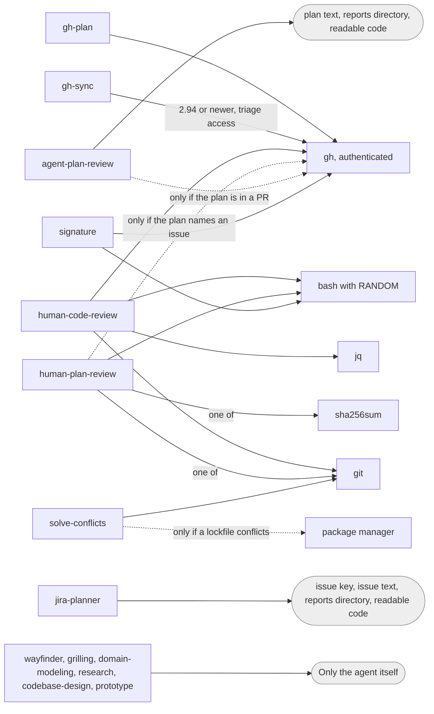

# How the skills fit together

Mermaid diagrams of the skills in this repository.

Legend: a solid arrow means the skill calls or hands over to the other one. A dotted arrow means a mention, a recommendation, or something that only happens when needed. Grey rounded boxes are not skills.

## 1. Planning: which skill uses which

## 2. Review, the GitHub track and signature

## 3. Where each skill fits in the work

## 4. jira-planner step by step

## 5. wayfinder: charting and working through the map

## 6. The quiz in human-code-review and human-plan-review

## 7. What each skill needs before it starts

Every skill with requirements has a hard gate: it stops and says what is missing. The diagram shows tools and, in grey, the inputs and files a skill needs.

