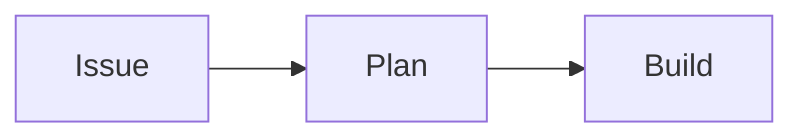

# Examples

## Command

User: `gh-plan 210` or `/gh-plan 210`

1. Announce the skill.
2. `SwitchMode` → `plan` (if not already there).
3. `gh issue view 210 --json number,title,url,state,body,labels,comments,parent,subIssues,...`
4. Read the code against the issue. Answer what can be settled in the repo.
5. Write a Cursor plan with `**Tracking:** [#210](url)`.
6. Ask open questions (for example about a feature flag).
7. Hard stop. No code.

## Minimal plan shape

```markdown
---
name: Short title from the issue
overview: One or two sentences about the goal.
todos:
  - id: tdd-core
    content: Failing test, minimal code, green
    status: pending
  - id: docs
    content: Update documentation
    status: pending
isProject: false
---

# Title

**Tracking:** [#210](https://github.com/OWNER/REPO/issues/210).

## In brief

[What the user gets. No file paths.]

## Decisions

- Locked: …
- Assumption (question): …



## PR plan

### PR A — … ([#101](https://github.com/OWNER/REPO/issues/101))

- Branch from the default branch
- TDD
- Documentation

## PR description

### PR A

**Summary:** …
**Branch:** from the default branch, `snake_case` service name.
**TDD:** red–green along the way.
**Documentation:** …
**QA:** …

## Follow-up

- Later work without a `#` yet, or an existing `#N`

## QA

- [ ] …
```

If the issue has sub-issues `#101` / `#102`: they are PR A / PR B. Do not create parallel PR items without a number.

## After questions are answered

Update the same plan. Ask new questions if anything is still open. Hard stop again. Only on **Build** do you leave the skill.
